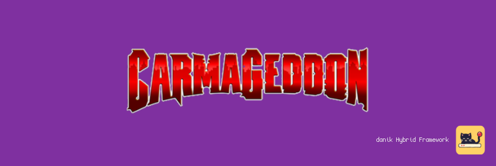
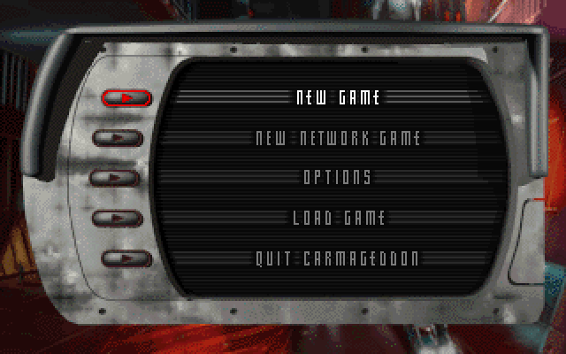

# Dethrace for MiSTer

Carmageddon (1997) and its Splat Pack on [MiSTer FPGA](https://github.com/MiSTer-devel/Main_MiSTer/wiki) as a hybrid port.

The game itself is [dethrace](https://github.com/dethrace-labs/dethrace), the open source reimplementation of Carmageddon. It runs on the MiSTer's ARM CPU. The Dethrace FPGA core provides native 320x200 and 320x240 15kHz video (CRT, VGA and HDMI), 44.1kHz audio and keyboard, mouse and gamepad input. The two halves talk through shared DDR3 memory.

> **Beta.** Expect rough edges and please report problems in the issues.
>
> **Disclaimer:** AI is being extensively used to speed up development, but the project is well-maintained and supported.

  
  

## Requirements

- **danik_hybrid_ports**, the launcher: run it **once** from the MiSTer's `Scripts` menu ([The launcher](#the-launcher)). Without it the core says "Game not running".
- **Game data**, which is not included: the `DATA` folder of Carmageddon, from your original CD or the GOG release (Carmageddon Max Pack), and optionally that of the Splat Pack, or of a demo.
- **Recommended:** a gamepad with two analog sticks and analog triggers, like an Xbox or PlayStation controller. A gamepad without them works but is not recommended. The game can also be played with a keyboard.

## Installation

With `update_all` (Downloader 2.4 or newer, which update_all keeps up to date):

1. Copy [`downloader_danik_hybrid_ports.ini`](https://raw.githubusercontent.com/ItsDanik/Hybrid_MiSTer/main/launcher/downloader_danik_hybrid_ports.ini) to the root of your SD card (`/media/fat`).
2. Run `update_all`. That installs the launcher, **danik_hybrid_ports**, in `Scripts`.
3. Run **danik_hybrid_ports** from the `Scripts` menu, tick the games you want and press *X: Apply*. They are installed, and update_all keeps them up to date.
4. Copy **everything** in your games' folders to `/media/fat/games/dnk/Dethrace/`, the folders whole and as they are, and leave nothing out:

   | Game | Folder |
   |---|---|
   | Carmageddon | its `DATA` folder to `/media/fat/games/dnk/Dethrace/DATA` (`DATA/GENERAL.TXT` must exist) |
   | Carmageddon: Splat Pack (optional) | its `DATA` folder to `/media/fat/games/dnk/Dethrace/SPLATPAK/DATA` |
   | CD music (optional, GOG release) | the `MUSIC` folder (`Track02.ogg` ...) to `/media/fat/games/dnk/Dethrace/MUSIC`, the Splat Pack's to `SPLATPAK/MUSIC` |
5. Load the game from the `Other` menu, e.g. **dnk-Carmageddon**, or from the `Hybrid Ports` folder if you moved the games there in the launcher.

> [!NOTE]
> The game data can go on a USB drive instead, into the same folder there (`/media/usb0/games/dnk/Dethrace/`): the game looks for it there first, and then keeps its settings and saved games there as well. Everything else stays on the SD card.

A menu entry starts the demo of its game when the full game is not there. When a game's files are missing, the core says which files to copy where. Each game keeps its own OSD settings and button mappings. The core file itself (`_Other/dnk/dnk-Dethrace_*.rbf`, or from *Recent*) lists the games that are there to pick from; quitting a game then returns to the list, otherwise to the MiSTer menu. The game's log is in `/media/fat/logs/dnk/Dethrace/dethrace.log`.

## The launcher

**danik_hybrid_ports** is what turns a menu entry into a running game. Once you've run it from the `Scripts` menu, it starts with the MiSTer, watches which core is loaded, and starts the game whenever a hybrid port's menu entry is loaded. It serves all our hybrid ports at once and updates itself through `update_all`.

Run it from the `Scripts` menu again whenever you want to change something. Its screen has:

- **Launcher**: on or off. Off, the ports' games no longer start (the core says "Game not running"), until you turn it on again.
- **Menu entries**: where the games appear in the MiSTer menu:
  - **Other, as dnk-\<Title\>**: each game in the `Other` menu, e.g. **dnk-Doom** (the default).
  - **Other/Hybrid Ports**: all of them in a *Hybrid Ports* folder in `Other`, without the `dnk-` in front.
  - **Main menu/Hybrid Ports**: a *Hybrid Ports* folder of its own in the main menu, next to `Arcade`, `Console` and `Other`.

  Moving them keeps each game's settings and button mappings. Favourites, recent lists and Zaparoo tags that point at the old place have to be made again.
- **The ports and their games**, a tickbox each. Tick what you want, untick what you don't.

*X: Apply* installs what is ticked and removes what is not, through Downloader, and moves the menu entries if you chose another place. When a port is removed, your game data, saved games and settings stay, and ticking it again brings it back as it was.

## OSD options

| Option | |
|---|---|
| Aspect ratio, Scale, Scandoubler Fx, Stereo Mix | as in other cores |
| FPS Counter | shows the pictures per second in the top left corner |
| HDMI Only | **Yes** if no CRT is connected: resolutions of 640x400 and more are then progressive instead of interlaced, and so is the core's own screen before the game, which moves at 60 pictures a second for a CRT and shows fine lines on HDMI without it. The analog output is switched off while one is shown, so that a 15kHz screen can never get such a signal. Dethrace has no such resolution, so nothing changes in the game. Not needed with `forced_scandoubler=1` (VGA monitor); not there with `direct_video=1` |
| CRT Options | **Horizontal Size**: the picture's width **Horizontal Pos**: moves it left or right **Vertical Pos**: moves it up or down **HUD (Top)**: lifts the instruments at the top 0 to 24 lines off the top edge (default 0), in races at 320x240 **HUD (Bottom)**: lifts the instruments at the bottom 0 to 24 lines off the bottom edge (default 0), in races at 320x240  For a 15kHz screen: fits the picture to it and keeps the instruments out of the overscan. HDMI is not affected; not there with `forced_scandoubler=1` |
| Sound Volume | master volume of sound effects and cutscene audio, on top of the game's own setting |
| Music Volume | master volume of the CD music, on top of the game's own setting |
| Resolution | **320x200**: the original mode (default) **320x240**: the race view from outside the car in 240 lines, finer vertically  The instruments keep their size and sit at the HUD margins; menus, the cockpit view, the map and a reduced view stay 320x200. About 10% more time per frame. Applies at once |
| Renderer | **Optimized**: rewritten rasteriser, the same picture (default) **Fast**: simpler perspective texturing, 20-25% faster **Original**: the original rasteriser code  The Fast renderer's picture is nearly the same as the others' |
| Lock to 30 FPS | **Off**: the frame rate floats between 30 and 60 fps (default) **On**: every frame shown for two fields, 29.8 fps  Steadier motion, best together with the Fast renderer |
| Cutscenes | **On**: the intro and the other videos (default) **Off**: skips them |
| Rumble | **On**: when the car is hit, the harder the stronger (default) **Off**: no rumble |
| Cheats | In a race: **Invulnerability**: the car takes no damage **Instant Repair**: repairs the car **Extra Credits**: 10000 credits **Finish Lap**: completes the lap (the last one, the race) |
| Reset | starts the game again from its beginning, as the USER button does |
| Save Diagnostic Report | the last line: see [If something is wrong](#if-something-is-wrong) |

## Controls

- **Keyboard:** the original PC controls.
- **Gamepad** in a race (default mapping):

| Button | Action |
|---|---|
| Left stick | Steer, analog: the further you push, the sharper the turn |
| D-pad | Steer |
| Right trigger (RT / R2) | Accelerate, analog: as hard as you press |
| Left trigger (LT / L2) | Brake, analog: as hard as you press |
| B (Xbox A / PlayStation Cross) | Accelerate |
| Y (Xbox X / PlayStation Square) | Brake |
| A (Xbox B / PlayStation Circle) | Handbrake |
| X (Xbox Y / PlayStation Triangle) | Change View |
| L (LB / L1) | Repair |
| R (RB / R1) | Map |
| Select | Recover |
| Start | Pause (Esc) |
| Racing wheel | Steer with the wheel; gas and brake with the pedals, analog (the wheels MiSTer knows) |
| (none by default) | Pratcam on/off (key P): give it a button in *Define Dethrace buttons* |

Change the buttons in the OSD under *Define Dethrace buttons*. *Menu OK* and *Menu Back* there are only needed for a spare button without a game function. While the OSD is open, the game gets no input.

> [!WARNING]
> A button left without a name in *Define Dethrace buttons* does not reach the game at all, except L2/R2, L3/R3 and *Menu OK* / *Menu Back*. Name every button there, or leave the definition as it is. To go back to the default buttons, delete `config/inputs/Dethrace_*_input_*_v3.map` (each game has its own) on the SD card.

## If something is wrong

If the game stutters, the sound breaks up or something else is wrong, open the OSD while it happens and pick **Save Diagnostic Report**, the last line of the menu. The game keeps running; MiSTer's info box says the report is saved in `games/dnk/diagnostics/` on the SD card. Send that file (`Dethrace_<date>_<time>.zip`) with a few words on what went wrong.

The report has the setup (versions, the video and audio lines of `MiSTer.ini`, the OSD settings), how the last 60 seconds went, the game's log and a screenshot. Nothing else: no network settings, addresses, saved games or lists of your files.

## Building

How the port works, how to build it and notes for development: [NOTES.md](NOTES.md).

## Support

If you enjoy this project, you can support my work on [Patreon](https://www.patreon.com/itsdanik).

## Credits

- **[dethrace](https://github.com/dethrace-labs/dethrace)** by Jeff Harris and the dethrace-labs contributors: the reimplementation of Carmageddon this port is built on.
- **[BRender](https://github.com/dethrace-labs/BRender-v1.3.2)** by Argonaut Software, released under the MIT license.
- **[MiSTer](https://github.com/MiSTer-devel)** by Sorgelig and the MiSTer-devel contributors: the framework and Template_MiSTer.
- **[MiSTer Frontier](https://github.com/MiSTerOrganize/MiSTer_Frontier)** by MiSTer Organize: thank you for the inspiration. Hybrid cores on the MiSTer, and the way their game is launched (a daemon that watches the loaded core and runs a script from its games folder), were inspired by MiSTer Frontier.

This project and its maintainers are in no way associated with or endorsed by SCi, Stainless Software or THQ Nordic. It does not include any Carmageddon game data, and it may only be used with assets from a copy of Carmageddon that you own.

## License

The top-level scripts, tools and documentation are licensed under the [GPL-3.0](LICENSE). The components keep their own licenses: dethrace (see `dethrace/LICENSE` and the Legal section of `dethrace/README.md`, including its non-commercial use condition), BRender is MIT (`dethrace/lib/BRender-v1.3.2/LICENSE`), the part of the shared framework the game is linked with (`hybrid/hps/`) is GPL-2.0-or-later, the rest of `hybrid/` GPL-3.0 except where its files say otherwise, and the FPGA core and the MiSTer framework are GPL-2.0 (`core/LICENSE`, with the core's own sources GPL-2.0-or-later).
